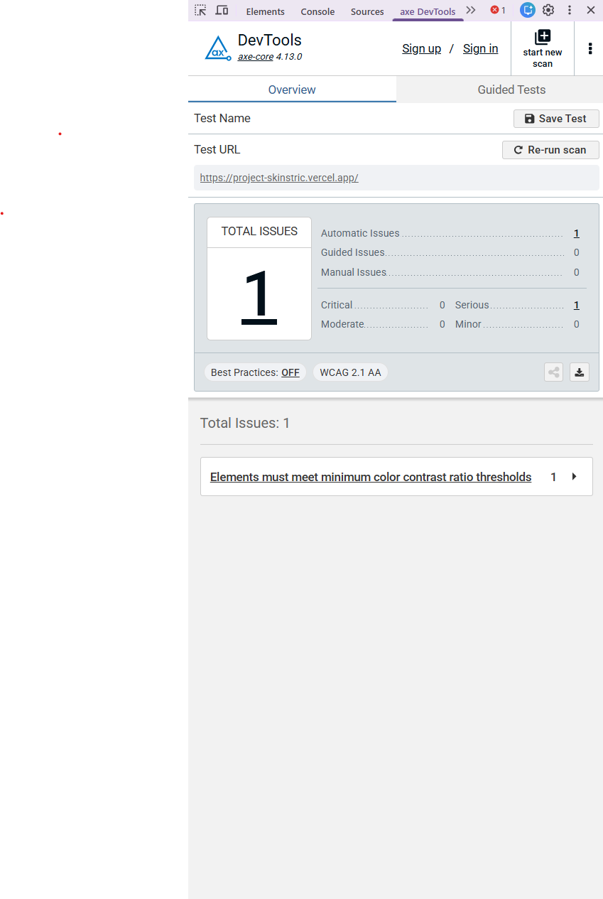
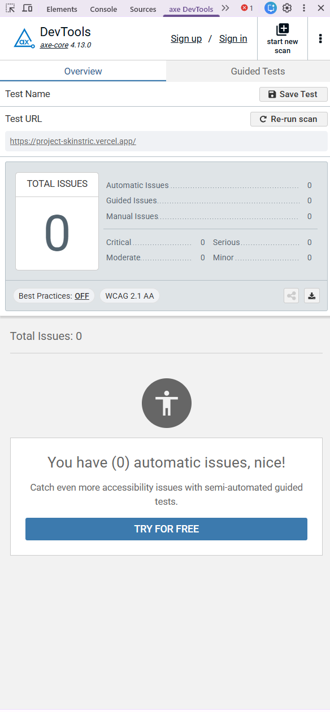

# Skinstric Frontend Clone

A high-fidelity frontend clone of the Skinstric AI-powered skin analysis and diagnostics platform, built with modern web technologies.

## 🚀 Tech Stack

- **Framework:** [Next.js](https://nextjs.org/) (App Router)

- **Language:** TypeScript

- **Styling:** Tailwind CSS

- **Icons & Assets:** Custom image assets & SVG visualizations

- **State Management:** React Hooks & LocalStorage persistence

## ✨ Key Features

- **A.I. Demographics Analysis:** Interactive breakdown and visualization of predicted race, age, and gender metrics.

- **Dynamic Circular Progress:** Custom SVG-based progress bars reflecting confidence scores.

- **Fully Responsive Design:** Seamless layout transitions across mobile, tablet, and desktop viewports.

- **Accessibility (A11y):** Full keyboard navigation support (`Enter`/`Space` handlers) and ARIA attributes for
  custom tab and radio components.

## 🗺️ Development Roadmap & Commit Strategy

This project is built and committed incrementally following a structured multi-phase strategy:

1. **Initial Setup & Documentation**
   - Project scaffolding, Next.js configuration, Tailwind setup, and initial `README.md`.

2. **Core Layouts & Navigation**
   - Global header, footer navigation components, and base page skeletons.

3. **A.I. Analysis & Data Visualization**
   - Integration of API services, demographic selection, and dynamic SVG circular progress bars.

4. **State Persistence, Error Handling & Polish**
   - LocalStorage synchronization, `try...catch` data parsing guards, keyboard accessibility (ARIA), and final responsiveness tweaks.

## ♿ Accessibility & Quality Assurance (WCAG 2.1 AA)

This application was audited and refactored to meet strict WCAG 2.1 AA accessibility standards, ensuring full screen-reader compatibility and keyboard navigation.

### Audit Results

- **Lighthouse Accessibility Score:** 100% 🟢
- **axe DevTools Violations:** 0 errors / 0 warnings

### Key Accessibility Enhancements

- **High-Contrast Compliance:** Standardized text and placeholder contrast tokens (`text-gray-700`, `placeholder-gray-500`) to meet the strict 4.5:1 ratio threshold.
- **Keyboard Navigation & Focus:** Replaced non-semantic click handlers with accessible `<button>` elements, ensuring visible focus states and full `Enter`/`Space` activation across multi-step flows.
- **Screen Reader Support:** Implemented `role="status"` with `aria-live="polite"` for dynamic processing feedback, `aria-describedby` for error linkages, and `aria-hidden="true"` for decorative graphics and animations.

---

### axe DevTools Audit: Before & After

| Before Accessibility Refactor                                            | After WCAG 2.1 AA Compliance                                     |
| :----------------------------------------------------------------------- | :--------------------------------------------------------------- |
|            |      |
| _Identified contrast gaps, unlabelled elements, and missing ARIA roles._ | _Zero errors or warnings — fully verified and production-ready._ |
